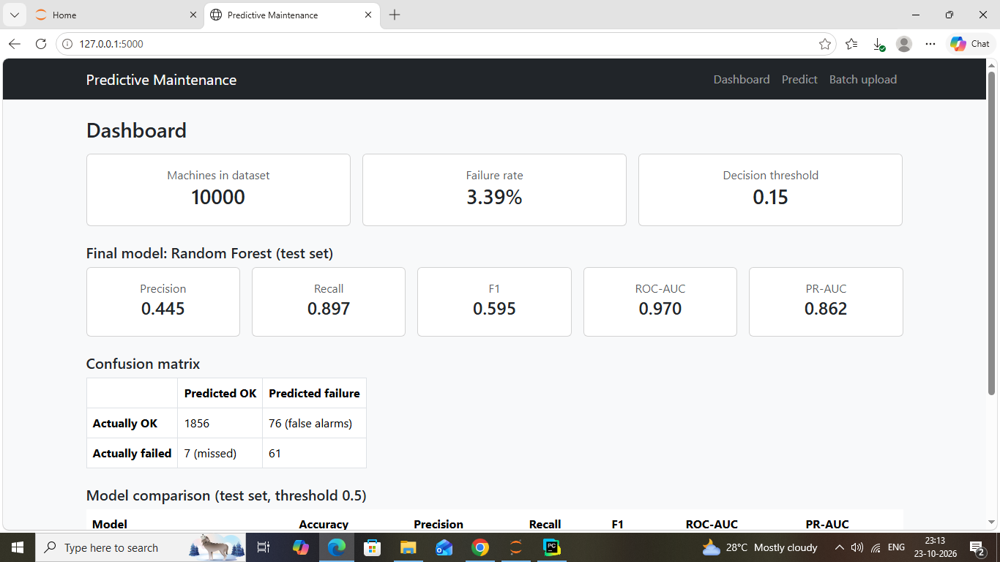
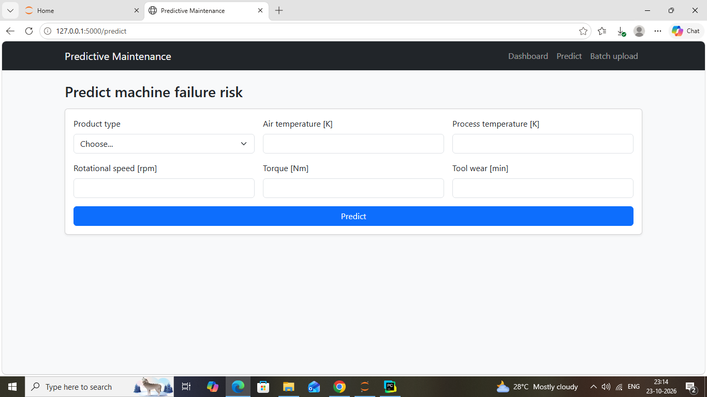
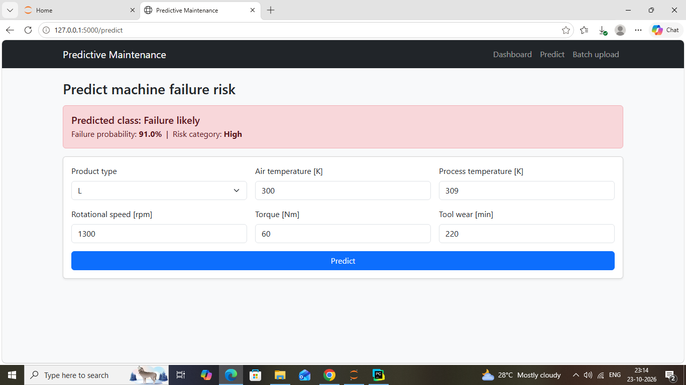
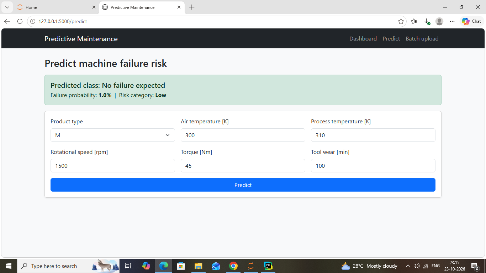
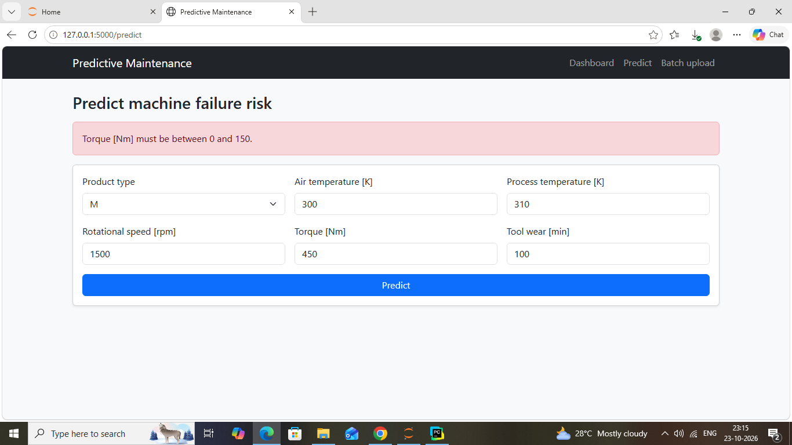
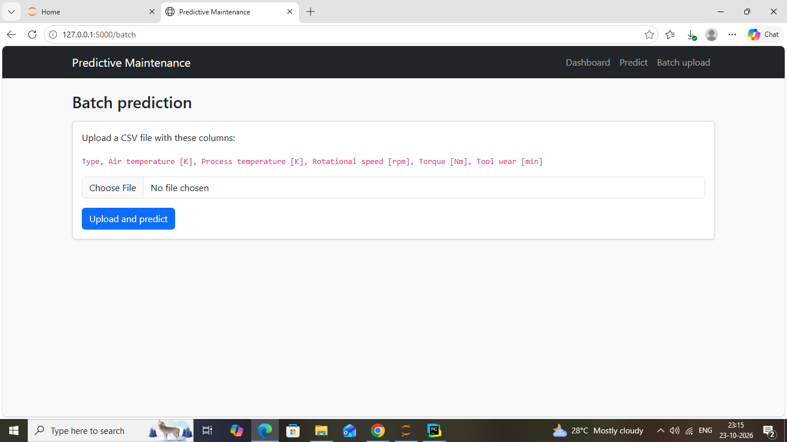
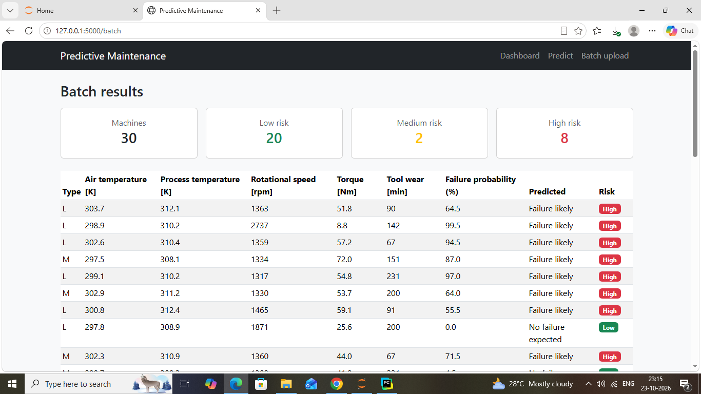
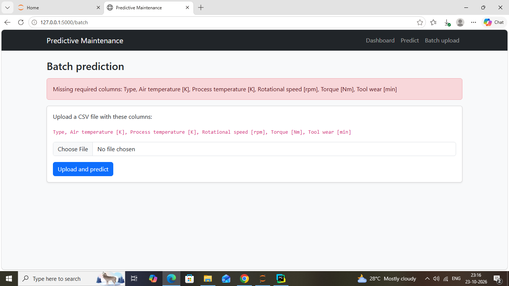

# Predictive Maintenance System using Machine Learning and Flask

A machine learning web application that estimates the failure risk of an industrial machine from its operating conditions and sensor readings. The project includes a full analysis notebook, a trained Random Forest model, and a Flask web app with a dashboard, a prediction form and CSV batch prediction.

## Problem Statement

Unexpected machine failures cause production downtime, damaged equipment and expensive repairs. If risky machines can be identified in advance, maintenance can be planned before a breakdown happens. This project predicts the probability that a machine will fail from its product type, temperatures, rotational speed, torque and tool wear.

Because a missed failure is more costly than an unnecessary inspection, the model is evaluated and tuned with this trade-off in mind instead of relying on accuracy alone.

## Dataset

The project uses the AI4I 2020 Predictive Maintenance Dataset (UCI Machine Learning Repository), a synthetic dataset modelled on real industrial data.

- 10,000 machines, with no missing values and no duplicates
- Inputs: product type (L, M, H), air temperature [K], process temperature [K], rotational speed [rpm], torque [Nm], tool wear [min]
- Target: Machine failure (0 = no failure, 1 = failure)
- Only 3.39% of machines fail, so the data is highly imbalanced
- The dataset also contains five failure-type columns (TWF, HDF, PWF, OSF, RNF). These were removed because they describe why a machine failed and would leak the answer (see Methodology)

Because the data is synthetic, real-world performance may differ.

## Methodology

1. **Data cleaning and leakage prevention.** The columns TWF, HDF, PWF, OSF and RNF were dropped because the target is almost entirely determined by them, and they are not known before a failure happens. UDI and Product ID were dropped as identifiers.
2. **Exploratory data analysis.** Eight visualizations with written insights are in the notebook: failure distribution, sensor distributions, box plots by failure, failure rate by product type, correlation heatmap, torque versus rotational speed, tool wear versus failure, and air versus process temperature. Failures cluster at extreme torque and speed, at high tool wear, and at a small gap between process and air temperature.
3. **Feature engineering.** Three features were created:
   - `temp_diff`: process temperature minus air temperature (heat dissipation)
   - `power_W`: torque multiplied by angular speed (rpm converted to rad/s)
   - `torque_wear`: torque multiplied by tool wear (load on a worn tool)
4. **Preprocessing.** The data was split first (80% train, 20% test, stratified, random_state 42). Numeric features are standardised and product type is one-hot encoded inside a scikit-learn Pipeline, so these steps are fitted on training data only and no information leaks from the test set.
5. **Model training and tuning.** Logistic Regression, Decision Tree, Random Forest and an Artificial Neural Network (MLPClassifier) were tuned with GridSearchCV and stratified 5-fold cross-validation, scoring on PR-AUC (average precision). Class weights were used where supported. The neural network in scikit-learn does not support class weights.
6. **Evaluation.** Models were evaluated on the untouched test set (2,000 machines, 68 failures) with confusion matrices, accuracy, precision, recall, F1, ROC-AUC and PR-AUC, plus ROC and precision-recall curves and feature importance.

## Model Comparison

Test set results at the default threshold of 0.5:

| Model | Accuracy | Precision | Recall | F1 | ROC-AUC | PR-AUC |
|---|---|---|---|---|---|---|
| Logistic Regression | 0.850 | 0.170 | 0.882 | 0.285 | 0.931 | 0.440 |
| Decision Tree | 0.948 | 0.391 | 0.926 | 0.550 | 0.956 | 0.876 |
| Random Forest | 0.992 | 0.933 | 0.824 | 0.875 | 0.970 | 0.862 |
| ANN | 0.982 | 0.746 | 0.735 | 0.741 | 0.980 | 0.821 |

Cross-validated PR-AUC on the training data: Logistic Regression 0.486, Decision Tree 0.830, Random Forest 0.888, ANN 0.769.

## Final Model and Threshold

**Selected model: Random Forest** (200 trees, balanced class weights).

Reasons:
- It had the best F1 score (0.875) and very few false alarms (4 at the default threshold)
- It had the best cross-validation score (0.888), which is more reliable than a single test set containing only 68 failures
- It outputs probabilities, so the alarm threshold can be adjusted to the business need
- Logistic Regression performed poorly (precision 0.17), which suggests failures depend on non-linear combinations of features

The ANN had the highest ROC-AUC and the Decision Tree a slightly higher test PR-AUC, but the differences are small given the limited number of failures in the test set.

**Missed failures versus false alarms.** A missed failure means unplanned downtime and possible equipment damage, while a false alarm only means an unnecessary inspection. For this reason the decision threshold was lowered from 0.5 to 0.15. The threshold was chosen using cross-validated predictions on the training data only, so the test set stayed untouched.

Test set results at threshold 0.15:

| | Predicted no failure | Predicted failure |
|---|---|---|
| Actually no failure | 1856 | 76 (false alarms) |
| Actually failed | 7 (missed) | 61 |

- Recall: 89.7% (61 of 68 failures caught)
- Precision: 44.5% (roughly one alert in two is a real failure)
- ROC-AUC: 0.970, PR-AUC: 0.862

**Explainability.** Random Forest feature importance shows that rotational speed, power, torque and tool wear are the most influential features, which agrees with the exploratory analysis. Feature importance shows what the model relies on, not what causes failures.

## Flask Web Application

- **Dashboard:** dataset statistics, final model metrics, confusion matrix and the model comparison table. All values are read from `models/model_info.json`, which is written by the notebook, so nothing is hardcoded.
- **Prediction form:** enter the machine parameters to get the predicted class, the failure probability and a risk category.
- **Batch prediction:** upload a CSV file to get predictions for many machines, with summary counts and a results table with risk categories.
- **Risk categories:** Low (probability below 15%), Medium (15% to 50%), High (50% or more).
- **Validation and error handling:** form inputs are checked for missing values, non-numeric values and out-of-range values. Uploaded files are checked for file type, size (2 MB maximum), row count (5,000 maximum), required columns, empty cells, valid product types and numeric ranges. Clear error messages are shown instead of crashing.
- **Interface:** HTML, CSS and Bootstrap.

The trained pipeline (scaler, encoder and Random Forest) is saved with joblib and loaded once when the app starts. The derived features are calculated by the same logic used in training.

## Screenshots

### Dashboard


### Prediction form


### High risk prediction


### Low risk prediction


### Input validation


### Batch upload


### Batch results


### Batch upload error handling


## Project Structure

```
predictive-maintenance-flask/
├── app/
│   ├── app.py                 Flask application
│   └── templates/             HTML pages (Bootstrap)
├── data/
│   ├── ai4i2020.csv           Dataset
│   └── sample_batch.csv       Sample file for batch prediction
├── models/
│   ├── rf_pipeline.joblib     Trained pipeline (preprocessing + Random Forest)
│   └── model_info.json        Threshold, feature order and evaluation results
├── notebooks/
│   └── predictive_maintenance.ipynb   EDA, preprocessing, training, evaluation
├── screenshots/               Application screenshots
├── src/
│   └── features.py            Derived feature function used by the app
├── requirements.txt
└── README.md
```

## Setup and How to Run

1. Clone the repository:
   ```
   git clone https://github.com/pcaswathiii/predictive-maintenance-flask.git
   cd predictive-maintenance-flask
   ```
2. (Recommended) Create and activate a virtual environment:
   ```
   python -m venv .venv
   .venv\Scripts\activate
   ```
3. Install the dependencies:
   ```
   pip install -r requirements.txt
   ```
4. Run the application:
   ```
   python app/app.py
   ```
5. Open http://127.0.0.1:5000 in your browser.

To use batch prediction, upload a CSV file with these columns: `Type`, `Air temperature [K]`, `Process temperature [K]`, `Rotational speed [rpm]`, `Torque [Nm]`, `Tool wear [min]`. A sample file is provided in `data/sample_batch.csv`.

To reproduce the analysis and retrain the model, open `notebooks/predictive_maintenance.ipynb` and run all cells. This regenerates the files in `models/`.

Note: the saved model should be loaded with the same scikit-learn version that trained it, so keep the versions in `requirements.txt`.

## Limitations and Future Work

- The dataset is synthetic, so results may not carry over to real machines.
- The test set contains only 68 failures, so the metrics are sensitive to a few machines.
- A single train/test split and small tuning grids were used. A wider search and repeated cross-validation would give more stable estimates.
- The neural network was trained without class weights.
- Random Forest probabilities are not calibrated, so they should be read as a risk score rather than an exact percentage.
- The input limits in the app are sanity checks, not engineering limits.
- The app is a local demonstration. For production it would need a production server, authentication, logging, tests and monitoring for changes in sensor behaviour.
- Possible improvements: gradient boosting models, probability calibration, per-prediction explanations, and deployment.

## Author

Aswathi - [GitHub](https://github.com/pcaswathiii) | [LinkedIn](https://linkedin.com/in/aswathi-p-c)

Developed as part of a Data Science internship project.